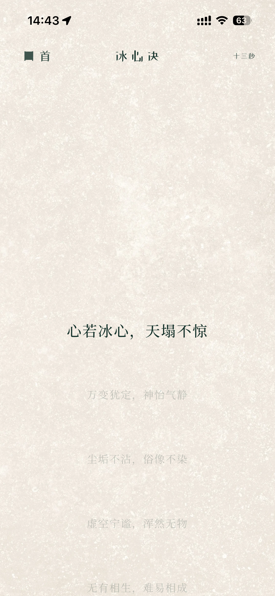
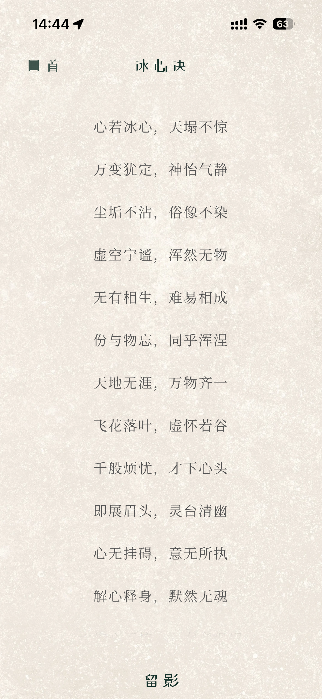
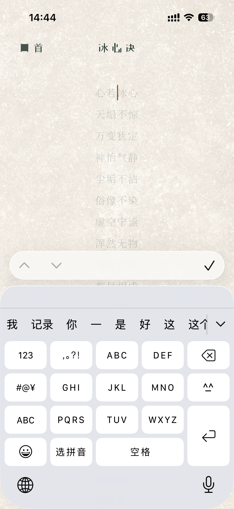
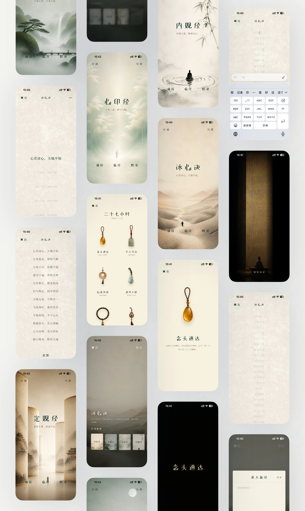

# 心斋 · Xinzhai


诵一卷经，留一刻静。面向 iPhone 的经文修习交互原型，包含经阁、诵持、临经、默录、功果与焚经完成仪式。

## 界面一览

以下截图沿用作品集中的实际应用展示。首页与经阁随所选经文更换图景，修习时回到暖纸与文字。

| 首页 · 三种修习入口 | 诵持 · 随句前行 | 临经 · 纸上书写与留影 | 默录 · 逐字输入 |
| --- | --- | --- | --- |
|  |  |  |  |

### 完整界面展示

与作品集使用同一张完整界面长图，展示选经、修习、录经、焚经和功果的连续体验。点击图片可查看大图。



### 焚经 · 念头通达

完成修习后，长按触发焚经，经过燃烧与过渡，最终回到“念头通达”。完整完成仪式可在作品集或本地可交互版本中体验。


### 功果 · 让投入留下形状

以珠串、玉佩等物件回应累计投入，采用完整展示的轮廓和克制的色彩。解锁状态与时间统计目前为原型演示。

<p align="center">
  
  
  
</p>

## 项目介绍

**为道日损，积微成常。** 从日常抄经出发，构建一段可以自然开始、从容结束的数字修习体验。

心斋是一款用于诵持、临经与默录的个人修习应用。从日常抄经出发，借助 AI 完成体验设计与手机 Web App。

- 项目类型：个人项目 · 2026
- 我的角色：产品设计与 AI 辅助实现
- 工作范围：体验、视觉、动效、开发验证

### 缘起于日常，成形于所需

在工作中，我曾借助 AI 开发内部工具，并看见它们进入日常使用。这让我想尝试独立完成一个属于自己的产品。受朋友启发，我开始在备忘录里每日抄写经文，留出一段专注的时间。后来，我希望练习能以不同方式展开，也让每一次完成得到恰当的回应。心斋由此有了最初的形状。

### 所求不多，从容始终

从选经到完成，让一次修习自然开始、从容结束。首页保留三个清晰入口：诵持随句前行，临经承接纸上书写与留影，默录通过逐字输入展开练习。经阁提供内置篇章和文本自录。

### 有所能为，亦有所不为

设计前期，我曾考虑加入连续打卡、经文对话和完成分享。随着体验逐渐清晰，我更希望心斋保持纯粹，让每一次练习自然发生，把注意力留给修习本身。因此，这三项功能最终没有纳入产品。

### 记所成，而不责所缺

完成分镜回应当下，功果物件回应积累。偶有停歇，也不抹去此前的投入。界面用纸、烟与光表达结束，让用户带着“念头通达”回到首页。当前功果界面采用演示状态，具体实现范围见下文。

### 让构想不止于纸上

从需求、界面到可在手机使用的 Web App，Codex 扩展了我的独立交付能力。需求取舍、视觉方向、交互反馈和最终验收由我主导，通过实现、预览与迭代逐步落实。

技术实现采用 React、TypeScript、Vite 与 Motion。此仓库提供可独立运行和编辑的网页应用源码，不依赖个人作品集工程。

## 本地预览与编辑

支持 macOS、Windows 和 Linux。请安装 Node.js 22.12 或更高的兼容版本（推荐 Node.js 22 LTS），安装包自带 npm。无需 Xcode、Codex、Sites 账号或 API 密钥。

1. 从 GitHub 下载 ZIP 并解压，或克隆仓库。
2. 在包含本文件和 `package.json` 的目录打开终端。如果仓库包含 `JingGeWeb` 子目录，先进入该目录。
3. 执行：

```sh
npm ci
npm run dev
```

打开终端显示的 Local 地址（通常是 http://localhost:5173）。端口被占用时，以终端实际地址为准。保持终端运行，按 Ctrl+C 停止。

首次安装依赖需要网络。部分字体通过在线服务加载，无法访问时使用回退字体。桌面显示手机预览框，窄屏直接显示应用。不同浏览器和地址的本地数据相互独立。

使用任意代码编辑器打开目录，修改并保存后浏览器自动更新：

- `src/Prototype.tsx`：主要页面、交互与动效。
- `src/prototype.css`：应用视觉样式。
- `src/scriptureData.ts`：内置经文。
- `public/assets/`：图片、纸纹、功果素材和仪式视频。

移动设备预览框和模拟键盘属于独立运行框架，修改前请阅读 `AGENTS.md`。普通应用内容编辑无需修改这些文件。

## 推荐体验顺序

首页 → 经阁选择常卷 → 诵持（轻触推进）／临经（选择照片）／默录（输入文字）→ 焚经（长按触发）→ 念头通达 → 功果及详情。

## 验证与构建

```sh
npm run check:runtime
npm run build
npm run test:sites
```

构建输出位于 `dist/client`，附带的 `dist/server` 用于原 Sites 托管流程。构建本身不发布网站，也不需要登录。

## 原型范围

- 已包含选经、文本自录、本机照片缓存、默录交互、诵持本次计时和焚经动效。
- 功果解锁、日期与总时长包含演示数据；完成次数初始值也包含演示设定。
- 网页版本尚未接入语音识别、图片 OCR、完整累计时长统计与动态成就系统。
- 数据保存在当前浏览器本机，不同步云端；清理站点数据会删除这些本地记录。

此仓库用于展示设计与交互实现，不应将演示数据理解为真实用户成果。仓库中的素材不附带额外的第三方商业使用授权。
